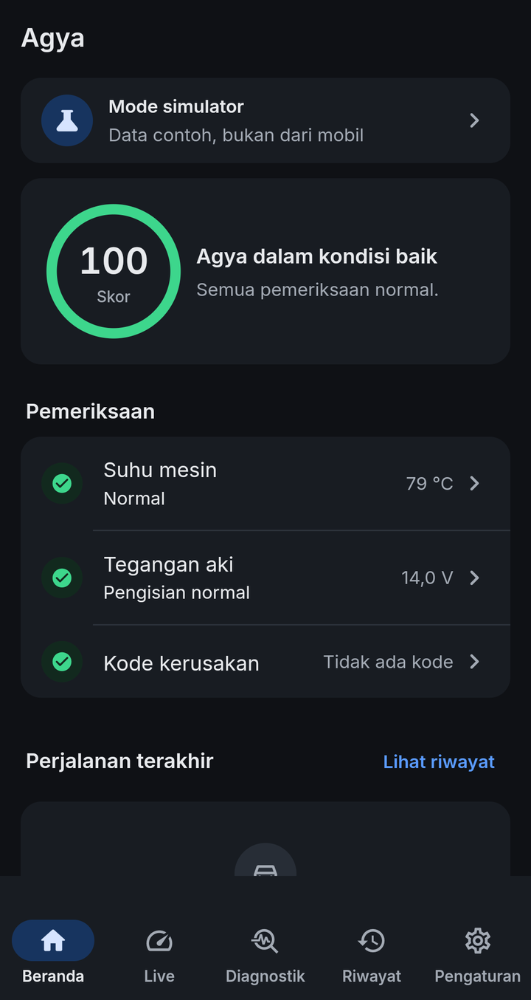
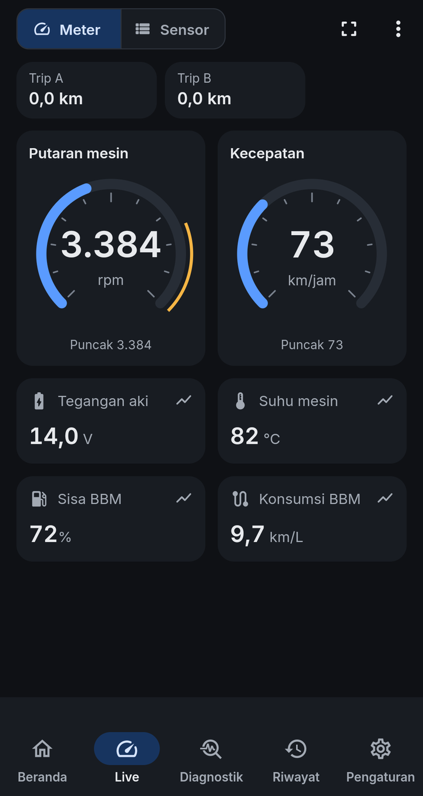
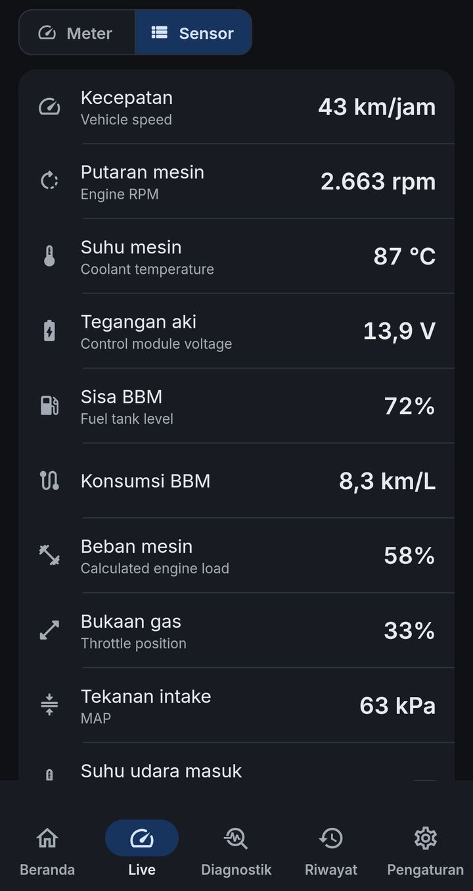
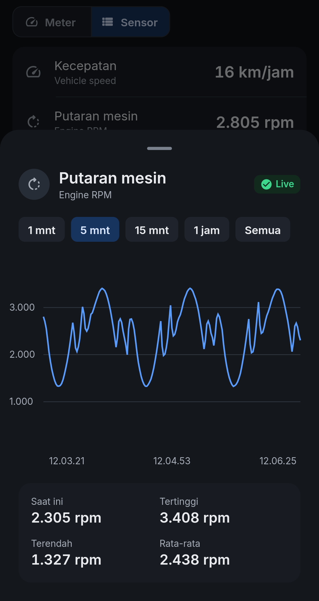
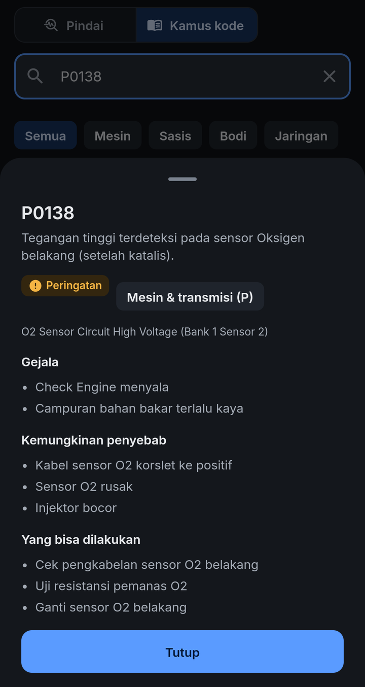
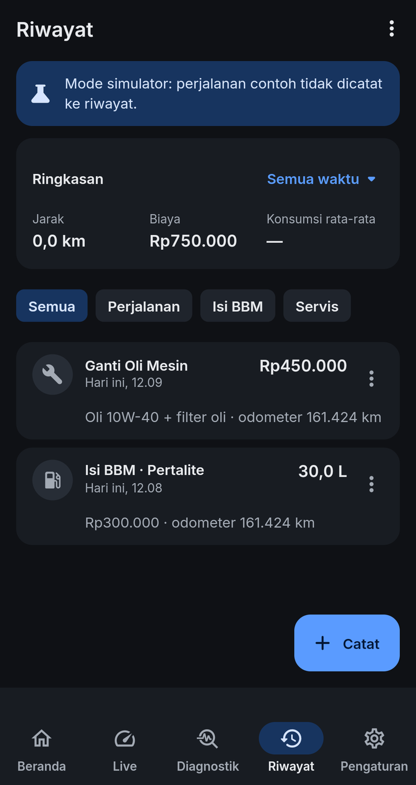
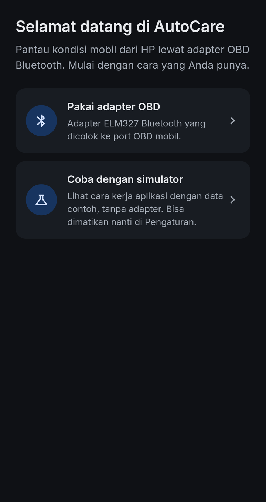
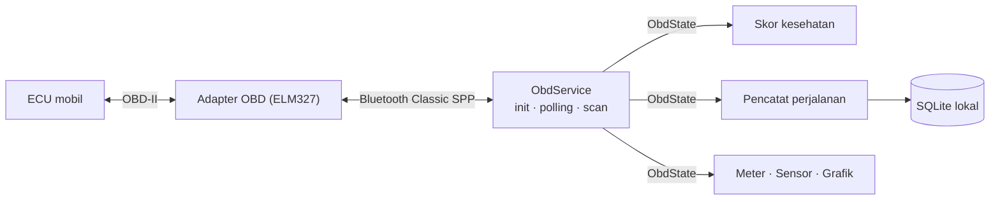

<p align="center">
  
</p>

<h1 align="center">AutoCare — OBD Scanner</h1>

<p align="center">
  <b>Teman senyap untuk mobilmu.</b><br>
  Ubah adapter OBD Bluetooth (ELM327) menjadi monitor kesehatan mobil: skor kesehatan, pindai kode kerusakan,<br>
  data live, serta riwayat perjalanan, isi BBM, dan servis. Semua dalam Bahasa Indonesia, semua tersimpan di HP.
</p>

<p align="center">
  <a href="https://flutter.dev"></a>
  
  
  
  
  <a href="LICENSE"></a>
</p>

<p align="center">
  <a href="https://rulyoctareza.github.io/OBD-Scanner/"><b>Situs</b></a> ·
  <a href="docs/alur-kerja.md"><b>Alur kerja</b></a> ·
  <a href="https://rulyoctareza.github.io/OBD-Scanner/privacy/"><b>Kebijakan privasi</b></a> ·
  <a href="docs/play-store.md"><b>Panduan rilis Play Store</b></a>
</p>

<details>
<summary><b>English summary</b></summary>

AutoCare turns a Bluetooth Classic ELM327 OBD-II adapter into a car health monitor for Android: a 0–100 health score with plain next steps, a trouble-code (DTC) scan with an offline Indonesian code dictionary, live gauges and sensor charts, and automatic trip, fuel and service history. It has no account, no ads, no analytics and no internet permission; everything stays in a local SQLite database. The UI is in Indonesian. Built with Flutter, Riverpod, go_router and Drift, tuned for low-end phones (reference device: Samsung Galaxy A6+, Android 10). A simulator mode lets you try every screen without an adapter. Licensed MIT.

</details>

---

## Daftar isi

- [Tampilan](#tampilan)
- [Fitur](#fitur)
- [Status proyek](#status-proyek)
- [Yang dibutuhkan](#yang-dibutuhkan)
- [Mulai pakai](#mulai-pakai)
- [Cara kerja singkat](#cara-kerja)
- [Ringan di HP kelas bawah](#performa)
- [Privasi](#privasi)
- [Pertanyaan umum](#faq)
- [Untuk pengembang](#pengembang)
- [Kontribusi](#kontribusi)

---

<a id="tampilan"></a>

## 📱 Tampilan

<table>
  <tr>
    <td align="center"><br><sub><b>Beranda</b></sub></td>
    <td align="center"><br><sub><b>Live · Meter</b></sub></td>
    <td align="center"><br><sub><b>Live · Sensor</b></sub></td>
    <td align="center"><br><sub><b>Live · Grafik sensor</b></sub></td>
  </tr>
  <tr>
    <td align="center"><br><sub><b>Diagnostik · Pindai</b></sub></td>
    <td align="center"><br><sub><b>Diagnostik · Kamus kode</b></sub></td>
    <td align="center"><br><sub><b>Riwayat</b></sub></td>
    <td align="center"><br><sub><b>Mulai: adapter atau simulator</b></sub></td>
  </tr>
</table>

<sub>Screenshot asli dari aplikasi di Samsung Galaxy A6+ dengan mode simulator.</sub>

---

<a id="fitur"></a>

## ✨ Fitur

| | Fitur | Isinya |
|---|---|---|
| ❤️ | **Skor kesehatan mobil** | Skor 0–100 dari suhu mesin, aki dan alternator, putaran idle, kode kerusakan aktif, dan jadwal ganti oli. Status normal, waspada, atau kritis, lengkap dengan langkah berikutnya dan tombol menuju layar yang tepat. Tanpa data, skor tidak ditampilkan: aplikasi tidak pernah mengaku mobil sehat sebelum memeriksanya. |
| 🛠️ | **Pindai kode kerusakan** | Baca kode kerusakan (DTC) aktif, tertunda, dan permanen, status lampu Check Engine, dan kesiapan uji emisi (I/M). Hapus kode kerusakan dengan konfirmasi, lalu aplikasi membaca ulang untuk memastikan kodenya benar-benar terhapus. Salin laporan pemindaian untuk bengkel. |
| 📖 | **Kamus kode** | Arti kode kerusakan dalam Bahasa Indonesia: gejala, kemungkinan penyebab, dan rekomendasi tindakan, dengan pencarian dan filter kategori. Bekerja tanpa internet. |
| ⏱️ | **Data live: Meter** | Dua gauge besar dan empat indikator kecil yang bisa diatur, petunjuk Hemat saat berkendara efisien, Trip A dan Trip B harian, plus mode kokpit layar penuh untuk posisi mendatar. |
| 📊 | **Data live: Sensor** | Putaran mesin, kecepatan, suhu mesin dan udara masuk, tegangan aki, MAP, MAF, bukaan gas, beban mesin, waktu pengapian, sisa BBM, perkiraan konsumsi BBM, dan grafik riwayat 1 menit sampai 1 jam. |
| 🧾 | **Riwayat perjalanan, isi BBM, dan servis** | Perjalanan tercatat otomatis (jarak, durasi, kecepatan rata-rata, suhu mesin tertinggi, km/L). Catat isi BBM dengan km/L metode isi penuh dan riwayat servis; mencatat ganti oli langsung memasang pengingat 5.000 km berikutnya. |
| 🔌 | **Menghubungkan tanpa ribet** | Cari dan pasangkan adapter dari dalam aplikasi (PIN 1234 otomatis), terhubung otomatis ke adapter terakhir, koneksi ulang sendiri bila adapter sempat tercabut, dan langkah perbaikan bila gagal. Koneksi tetap hidup saat layar mati. |
| 🪪 | **Identitas mobil** | Baca VIN dan odometer dari mobil (bila didukung), lalu terjemahkan VIN menjadi merek, model, dan tahun. Odometer juga bisa diisi manual. |
| 🧪 | **Mode simulator** | Coba semua fitur tanpa adapter dengan data contoh, termasuk simulasi mesin terlalu panas, aki lemah, dan lampu Check Engine. Data mobil contoh tidak pernah tersimpan sebagai mobilmu. |
| 🔤 | **Nyaman dibaca** | Teks sistem besar sampai 200 % tetap rapi: kata tidak terpotong di tengah, label mengecil sedikit bila perlu. Target sentuh minimal 48 dp dan kontras warna minimal 4,5:1. |
| 🔒 | **Privat** | Tanpa akun, tanpa iklan, tanpa izin internet. Semua data tersimpan di SQLite lokal. |

Navigasi aplikasi: **Beranda · Live** (Meter, Sensor) **· Diagnostik** (Pindai, Kamus kode) **· Riwayat · Pengaturan**.

---

<a id="status-proyek"></a>

## 🧭 Status proyek

AutoCare belum tersedia di Play Store; semua bahan listing sudah siap di [`fastlane/metadata/android/`](fastlane/metadata/android/) dan langkah rilisnya ada di [docs/play-store.md](docs/play-store.md). Untuk sekarang, pasang dengan build dari kode sumber (lihat [Untuk pengembang](#pengembang)).

| Bagian | Status |
|---|---|
| Semua layar, simulator, database, skor kesehatan | ✅ Diuji otomatis dan di HP (Samsung Galaxy A6+, Android 10) |
| Koneksi Bluetooth: urutan koneksi, polling, koneksi ulang, batal, putus, pindai, hapus kode | ✅ Diuji otomatis terhadap adapter ELM327 tiruan (109 test) |
| Koneksi ke adapter ELM327 sungguhan di mobil | ⏳ Belum diverifikasi; daftar ujinya ada di bawah |
| Izin Bluetooth Android 12 ke atas | ⏳ Belum diuji di perangkat (HP uji Android 10) |
| Koneksi saat HP tidak di-charge (Doze) dan pembatasan "app sleeping" Samsung | ⏳ Belum diuji |

<details>
<summary><b>Daftar uji di mobil</b> (membantu sekali bila kamu mencobanya)</summary>

Colok adapter ke port OBD, kontak ON. Jangan ketuk "Hapus kode kerusakan" kecuali kamu memang ingin menghapus kode di ECU mobil.

1. Beranda → **Hubungkan** → lembar "Adapter OBD" → ketuk adapter. Harus tampil "Membuka koneksi Bluetooth…", "Menyiapkan adapter ELM327…", "Mendeteksi protokol mobil…", lalu "Terhubung".
2. Aplikasi tetap terbuka dan notifikasi "AutoCare" muncul.
3. Live → Meter dan Sensor: nilai berubah dalam beberapa detik; sensor yang tidak dimiliki mobil ditandai tidak didukung.
4. **Putuskan**: kembali "Belum terhubung", notifikasi hilang. Ulangi hubungkan–putuskan lima kali.
5. Cabut adapter saat terhubung, lalu colok lagi: aplikasi tersambung sendiri dalam ±15 detik.
6. Diagnostik → **Pindai**: selesai dengan protokol dan VIN (bila mobil melaporkannya), data live tetap berjalan.
7. Lupakan adapter di pengaturan Bluetooth Android, lalu pasangkan lagi dari **Adapter OBD → Cari → Pasangkan**.
8. Pengaturan → **Hubungkan otomatis**: tutup aplikasi dari daftar aplikasi terbaru, buka lagi, harus tersambung sendiri.

Laporkan hasilnya lewat [issue](https://github.com/RulyOctareza/OBD-Scanner/issues/new/choose) beserta merek adapter, mobil, dan HP.

</details>

---

<a id="yang-dibutuhkan"></a>

## 🚗 Yang dibutuhkan

- **Adapter OBD Bluetooth Classic (ELM327).** Adapter khusus Bluetooth Low Energy (BLE) dan adapter Wi-Fi belum didukung.
- **Mobil dengan port OBD-II**, biasanya di bawah dasbor dekat setir. Kebanyakan mobil bensin modern memilikinya. Sensor yang tersedia tergantung mobil; sensor yang tidak dilaporkan mobil ditandai "Tidak didukung", bukan ditampilkan nol. Rumus perkiraan konsumsi BBM disetel untuk mesin bensin kecil (acuan: mesin 1.2 L).
- **HP Android 7.0 (API 24) atau lebih baru.** iOS belum didukung.

<a id="mulai-pakai"></a>

## 🚀 Mulai pakai

1. Colokkan adapter ke port OBD-II, lalu nyalakan kontak mobil.
2. Buka AutoCare, pilih **Pakai adapter OBD**, lalu izinkan **Perangkat di sekitar**.
3. Ketuk **Hubungkan**: lembar "Adapter OBD" terbuka. Ketuk **Cari**, lalu pilih adapter. PIN 1234 diisi otomatis.
4. Skor kesehatan di **Beranda** dan data di **Live** langsung terisi. Buka **Diagnostik → Pindai** untuk membaca kode kerusakan.
5. Isi **odometer** dan **jadwal ganti oli** di Pengaturan agar AutoCare bisa mengingatkan ganti oli.

Tidak punya adapter? Pilih **Coba dengan simulator** di layar pertama, atau nyalakan di **Pengaturan → Simulator**.

---

<a id="cara-kerja"></a>

## ⚙️ Cara kerja singkat



1. **Menghubungkan**: lembar koneksi memeriksa Bluetooth dan izin, lalu membuka socket RFCOMM dan menjalankan `AT Z` → `AT E0` → `AT SP 0` → `0100` untuk menyiapkan adapter dan mendeteksi protokol mobil.
2. **Membaca**: 12 perintah dikirim bergiliran, satu per satu, menunggu prompt `>` setiap kali (±10 jawaban per detik). Kode kerusakan dibaca di siklus pertama setiap koneksi, lalu kira-kira setiap 20 siklus.
3. **Menghitung**: setiap jawaban memperbarui satu state; skor kesehatan, perjalanan, dan grafik menghitung ulang dari state itu.
4. **Menyimpan**: perjalanan, BBM, servis, dan pengaturan masuk ke database lokal. Tidak ada yang dikirim ke internet.
5. **Tetap hidup di latar belakang**: selama adapter terhubung, foreground service Android (tipe `connectedDevice`) menjaga koneksi saat layar mati. Service berhenti begitu koneksi diputus; tidak ada yang berjalan saat HP menyala atau setelah pembaruan.

Penjelasan lengkap dengan diagram (urutan koneksi, status dan koneksi ulang, polling, pemindaian, skor kesehatan, perjalanan, database, simulator) ada di **[docs/alur-kerja.md](docs/alur-kerja.md)**.

---

<a id="performa"></a>

## ⚡ Ringan di HP kelas bawah

AutoCare diukur dan dioptimalkan di Samsung Galaxy A6+ (Snapdragon 450, Android 10) dengan beban seperti koneksi nyata: ±10 jawaban OBD per detik dan pencatatan perjalanan aktif. Tiap skenario dijalankan 3 kali di proses terpisah; angka di bawah adalah median.

| Skenario | Frame tersendat | CPU |
|---|---|---|
| Live · Meter saat berkendara | 38,8 % → **0,5 %** | 56 % → **29 %** |
| Live · Sensor saat berkendara | 71,0 % → **0 %** | 38 % → **14 %** |
| Beranda saat berkendara | 1,3 % → **0 %** | 59 % → **10 %** |
| Grafik sensor terbuka | 99,8 % → **12,0 %** | 113 % → **33 %** |
| Berpindah tab | 37,2 % → **4,1 %** | 59 % → **35 %** |
| Meter saat mesin idle | 68,3 % → **0 %** | 42 % → **5 %** |

- Beranda siap dipakai **1,9 s → 0,5 s** sejak aplikasi mulai; cold start build rilis 475 → 430 ms.
- Memori 21–48 MB lebih hemat per skenario.
- Caranya: tab yang tidak terlihat berhenti membangun ulang, widget hanya membangun ulang nilai yang memang tampil, grafik bekerja 1 kali per detik, database berjalan di isolate terpisah, font dikemas di aplikasi, dan animasi hanya berjalan saat nilai berubah.

---

<a id="privasi"></a>

## 🔒 Privasi

AutoCare tidak mengumpulkan atau membagikan data. Aplikasi tidak memiliki izin internet, akun, iklan, maupun analitik. Lokasi hanya diminta di Android 11 ke bawah karena Android mewajibkannya untuk mencari perangkat Bluetooth, dan tidak pernah dibaca. Selengkapnya di [kebijakan privasi](https://rulyoctareza.github.io/OBD-Scanner/privacy/).

---

<a id="faq"></a>

## ❓ Pertanyaan umum

<details>
<summary><b>Adapter apa yang cocok?</b></summary>

Adapter ELM327 dengan **Bluetooth Classic** (biasanya bernama "OBDII" atau "OBD II", PIN 1234 atau 0000). Versi BLE-only (sering dijual untuk iPhone) dan versi Wi-Fi belum didukung. Banyak adapter murah berupa klon ELM327; sebagian tidak menjawab semua perintah.

</details>

<details>
<summary><b>Apakah AutoCare bisa mematikan lampu Check Engine?</b></summary>

Bisa, lewat **Diagnostik → Hapus kode kerusakan**, dengan konfirmasi. Menghapus kode juga menghapus freeze frame dan status kesiapan uji emisi di ECU, dan lampu akan menyala lagi bila kerusakannya belum diperbaiki. Setelah menghapus, AutoCare membaca ulang dan hanya melapor berhasil bila kodenya benar-benar hilang.

</details>

<details>
<summary><b>Kenapa aplikasi meminta izin lokasi?</b></summary>

Hanya di Android 11 ke bawah, karena di versi itu Android mewajibkan izin lokasi untuk mencari perangkat Bluetooth baru. AutoCare tidak pernah membaca lokasi. Di Android 12 ke atas izin yang diminta adalah "Perangkat di sekitar".

</details>

<details>
<summary><b>Apakah adapter menguras aki mobil?</b></summary>

Adapter ELM327 menarik arus kecil selama tercolok. Bila mobil akan lama tidak dipakai, cabut adapternya. AutoCare sendiri hanya berkomunikasi saat terhubung.

</details>

<details>
<summary><b>Kenapa sebagian sensor tertulis "Tidak didukung"?</b></summary>

Setiap mobil hanya melaporkan sebagian PID OBD-II. AutoCare menanyakan mobil sensor apa saja yang didukung dan menandai sisanya, alih-alih menampilkan angka nol yang menyesatkan.

</details>

---

<a id="pengembang"></a>

## 🛠️ Untuk pengembang

### Tech stack

| Area | Pilihan |
|---|---|
| Framework | Flutter 3.35, Dart 3.9 |
| State | Riverpod 2.6 (`StateNotifier` + provider yang ditulis manual) |
| Navigasi | go_router 14 dengan `StatefulShellRoute` (5 tab) |
| Database | Drift 2.28 (SQLite) di isolate latar belakang, skema v3 dengan migrasi |
| Bluetooth | `flutter_bluetooth_serial` 0.4.0, **di-vendor** di `packages/` dengan patch Android ([LOCAL_CHANGES.md](packages/flutter_bluetooth_serial/LOCAL_CHANGES.md)) |
| Grafik | fl_chart |
| Latar belakang | Foreground service native (`ObdLinkService.kt`, tipe `connectedDevice`), hanya saat adapter terhubung |
| Tampilan | Material 3, tema gelap, font Inter yang dikemas di aplikasi |
| Render | Skia/OpenGL (Impeller dimatikan karena crash driver Vulkan di GPU lama seperti Adreno 506) |

### Struktur proyek

```text
lib/
├── core/
│   ├── bluetooth/   # ObdService (koneksi, init, polling, pemindaian), akses & pairing Bluetooth
│   ├── obd/         # parser PID/DTC/readiness, dekoder VIN, simulator
│   ├── database/    # skema Drift dan migrasi
│   ├── navigation/  # router
│   ├── services/    # jembatan ke foreground service native
│   ├── theme/       # tema, warna, tipografi
│   ├── ui/          # design system: token, status, format angka, komponen
│   ├── utils/       # helper grafik, laporan pemindaian
│   └── widgets/     # lembar koneksi adapter OBD, helper data live
├── features/
│   ├── splash/      # splash + layar pertama
│   ├── shell/       # navigasi bawah 5 tab
│   ├── health/      # Beranda: skor kesehatan (HealthEngine)
│   ├── live_data/   # Live: meter, sensor, grafik
│   ├── diagnostics/ # Diagnostik: pemindaian + kamus kode
│   ├── trips/       # pencatat perjalanan, Trip A/B
│   ├── timeline/    # Riwayat: perjalanan, isi BBM, servis
│   └── settings/    # pengaturan, simulator, identitas mobil
└── dev/             # adapter ELM327 tiruan dan harness benchmark (tidak ikut build rilis)
android/app/src/main/kotlin/…/       # MainActivity + ObdLinkService (foreground service)
packages/flutter_bluetooth_serial/   # plugin Bluetooth yang di-vendor
test/                                # unit, widget, koneksi (test/obd_link), performa (test/perf), UI (test/ui)
fastlane/metadata/android/           # teks dan gambar listing Play Store (id, en-US)
tool/                                # build terverifikasi, benchmark, pembuat aset listing
docs/                                # dokumentasi + situs GitHub Pages
```

### Menjalankan

```bash
flutter pub get
dart run build_runner build --delete-conflicting-outputs   # hanya setelah mengubah tabel Drift
flutter run
```

Koneksi asli butuh HP Android fisik dengan Bluetooth dan adapter OBD (ELM327). Tanpa itu, semua layar tetap bisa dicoba di emulator lewat mode simulator.

### Test dan analisis

```bash
flutter analyze
flutter test
```

299 test, semuanya berjalan tanpa HP:

- **Koneksi** (`test/obd_link/`): `ObdService` sungguhan terhadap adapter ELM327 tiruan (`lib/dev/fake_elm327.dart`) dengan waktu palsu: urutan init, polling, koneksi ulang dengan jeda bertahap, batal, putus, pemindaian, hapus kode dengan baca ulang.
- **Tata letak** (`test/ui/layout_matrix_test.dart`): setiap layar di lebar 320 dan 411 dp dengan teks sistem 100 %, 130 %, dan 200 %, plus status bar dan navigation bar. Gagal bila ada overflow, teks terpotong, atau kata yang patah di tengah.
- **Aksesibilitas** (`test/ui/a11y_test.dart`): target sentuh 48 dp dan label untuk pembaca layar; kontras warna di `theme_test.dart`.
- **Performa** (`test/perf/`): layar tidak membangun ulang saat tidak terlihat, gauge tidak memulai animasi ulang untuk nilai yang sama, grafik dibuang saat ditutup.

### Build rilis

```bash
tool/build_verified.sh appbundle --release
```

Skrip ini membungkus `flutter build` dan memastikan kode Dart terbaru benar-benar ikut terkemas (baris terakhirnya `SRC_REV=…`, yang juga tampil di Pengaturan › Tentang). Ini perlu karena path proyek yang berisi spasi bisa membuat Gradle memakai hasil kompilasi lama. Build rilis ditandatangani dengan upload key dari `android/key.properties` (tidak di-commit); tanpa file itu build ditandatangani dengan debug key. Cara membuat key, isian Play Console, dan checklist rilis ada di **[docs/play-store.md](docs/play-store.md)**. Screenshot dan grafis listing dibuat ulang dengan [`tool/store_assets/`](tool/store_assets/README.md).

### Benchmark

Harness benchmark (`lib/dev/bench/`, `tool/bench/`) dipasang sebagai paket terpisah `com.autocare.autocare.bench`, jadi tidak pernah menimpa aplikasi atau database aslimu. Ia memutar skenario di atas dengan adapter tiruan dan mencatat waktu build/raster per frame, CPU, dan memori:

```bash
tool/bench/run_bench.sh <folder-hasil>
dart run tool/bench/summarize.dart <folder-hasil> [<folder-pembanding>]
```

---

<a id="kontribusi"></a>

## 🤝 Kontribusi

Laporan bug dan usulan fitur sangat membantu, terutama yang menyertakan HP, adapter, dan mobil yang dipakai. Gunakan [template issue](https://github.com/RulyOctareza/OBD-Scanner/issues/new/choose). Pull request dipersilakan; jalankan `flutter analyze` dan `flutter test` sebelum mengirim.

> AutoCare membantu memantau kondisi mobil, tetapi bukan pengganti pemeriksaan di bengkel. Atur aplikasi sebelum berangkat, jangan sambil mengemudi.

## 📄 Lisensi

[MIT](LICENSE) © 2026 Fatchurizkia Ruly Octareza
