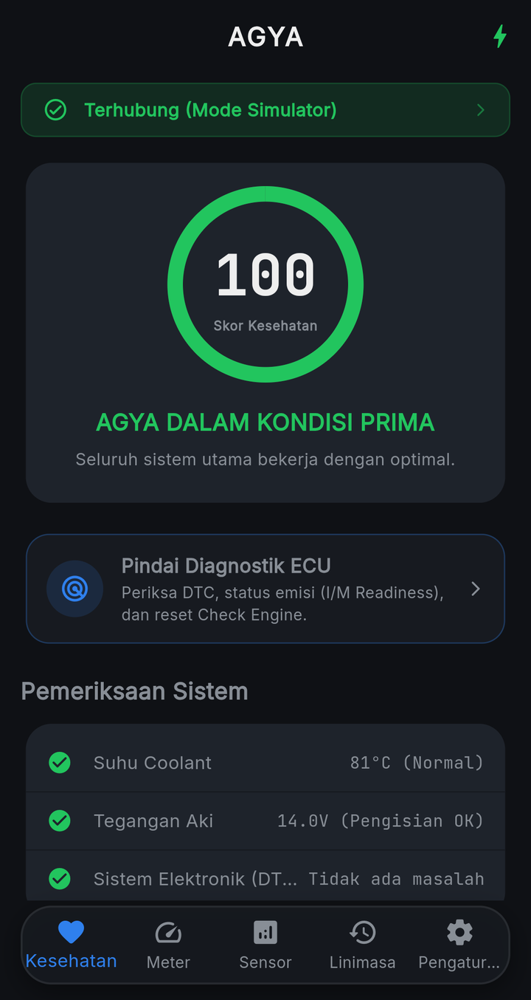
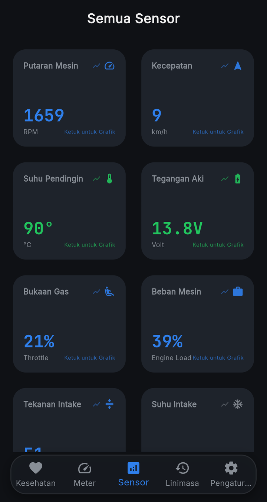
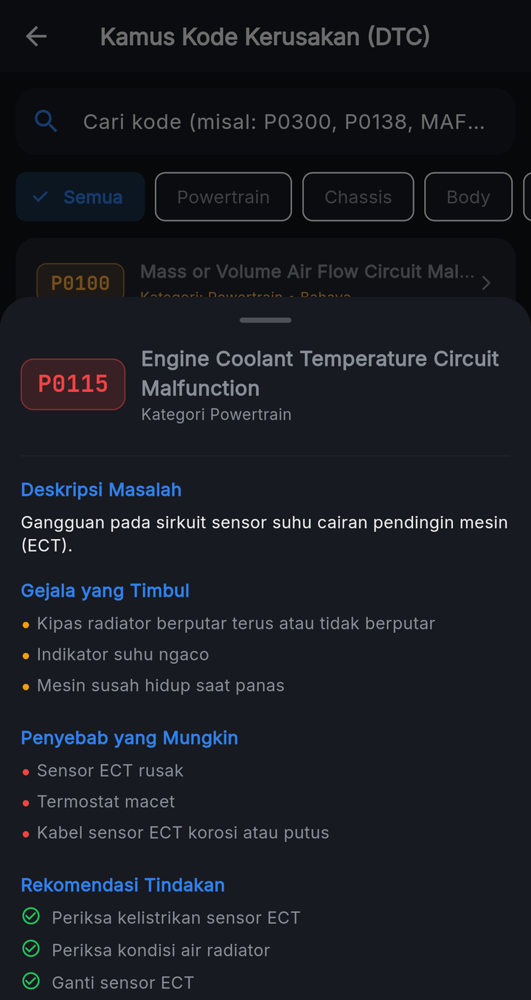
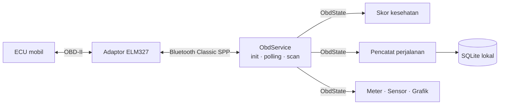

<p align="center">
  
</p>

<h1 align="center">AutoCare — OBD Scanner</h1>

<p align="center">
  <b>Teman senyap untuk mobilmu.</b><br>
  Ubah adaptor OBD-II Bluetooth ELM327 menjadi monitor kesehatan mobil: skor kesehatan, kode Check Engine,<br>
  live data, catatan perjalanan, BBM, dan servis. Semua dalam Bahasa Indonesia, semua tersimpan di HP-mu.
</p>

<p align="center">
  <a href="https://flutter.dev"></a>
  
  
  
  <a href="LICENSE"></a>
</p>

<p align="center">
  <a href="https://rulyoctareza.github.io/OBD-Scanner/"><b>Situs</b></a> ·
  <a href="docs/alur-kerja.md"><b>Alur kerja</b></a> ·
  <a href="https://rulyoctareza.github.io/OBD-Scanner/privacy/"><b>Kebijakan privasi</b></a> ·
  <a href="docs/play-store.md"><b>Panduan rilis Play Store</b></a>
</p>

---

## 📱 Tampilan

<table>
  <tr>
    <td align="center"><br><sub><b>Skor kesehatan</b></sub></td>
    <td align="center"><br><sub><b>Meter kokpit</b></sub></td>
    <td align="center"><br><sub><b>Semua sensor</b></sub></td>
    <td align="center"><br><sub><b>Grafik riwayat</b></sub></td>
  </tr>
  <tr>
    <td align="center"><br><sub><b>Scanner diagnostik</b></sub></td>
    <td align="center"><br><sub><b>Kamus kode DTC</b></sub></td>
    <td align="center"><br><sub><b>Linimasa BBM &amp; servis</b></sub></td>
    <td align="center"><br><sub><b>Mode Simulator</b></sub></td>
  </tr>
</table>

<sub>Screenshot asli dari aplikasi di Samsung Galaxy A6+ dalam Mode Simulator.</sub>

---

## ✨ Fitur

| | Fitur | Yang kamu dapat |
|---|---|---|
| ❤️ | **Skor kesehatan** | Skor 0–100 yang dihitung langsung dari suhu pendingin, aki dan alternator, putaran idle, kode kerusakan aktif, dan jadwal ganti oli. Setiap peringatan punya tombol menuju layar yang tepat. |
| 🛠️ | **Scanner diagnostik** | Baca DTC aktif (mode 03), pending (07), dan permanen (0A), status lampu Check Engine (MIL), dan kesiapan emisi (I/M Readiness). Reset Check Engine dan salin laporan untuk bengkel. |
| 📖 | **Kamus kode DTC** | Penjelasan kode error dalam Bahasa Indonesia: deskripsi, gejala, kemungkinan penyebab, dan rekomendasi tindakan, dengan pencarian dan filter kategori. |
| ⏱️ | **Meter kokpit** | Dua gauge besar dan empat indikator kecil yang bisa dipilih, badge ECO, Trip A dan Trip B harian, plus mode layar penuh. |
| 📊 | **Live data & grafik** | RPM, kecepatan, suhu pendingin dan udara masuk, tegangan aki, MAP, MAF, bukaan gas, beban mesin, timing advance, level BBM, estimasi km/L, dan grafik riwayat 1 menit sampai 1 jam. |
| 🧾 | **Perjalanan, BBM, servis** | Perjalanan tercatat otomatis (jarak, durasi, rata-rata, suhu maksimum, km/L). Catat isi BBM dengan km/L metode isi penuh dan riwayat servis, semuanya di linimasa dengan filter. |
| 🔌 | **Koneksi mudah** | Cari dan sandingkan ELM327 dari dalam aplikasi (PIN 1234 otomatis), sambung otomatis ke adaptor terakhir, dan langkah perbaikan bila gagal. |
| 🪪 | **Identitas kendaraan** | Baca VIN dan odometer dari ECU (bila didukung), lalu terjemahkan VIN menjadi merek, model, dan tahun. |
| 🧪 | **Mode Simulator** | Coba semua fitur tanpa mobil, termasuk simulasi overheat, aki lemah, dan Check Engine. |
| 🔒 | **Privat** | Tanpa akun, tanpa iklan, tanpa izin internet. Semua data tersimpan di SQLite lokal. |

---

## ⚙️ Cara kerja singkat



1. **Menyambung**: lembar koneksi memeriksa Bluetooth dan izin, lalu membuka socket RFCOMM dan menjalankan `AT Z` → `AT E0` → `AT SP 0` → `0100` untuk menyiapkan adaptor dan mendeteksi protokol mobil.
2. **Membaca**: 12 perintah dikirim bergiliran, satu per satu, menunggu prompt `>` setiap kali. Kode DTC dibaca setiap 20 siklus.
3. **Menghitung**: setiap jawaban memperbarui satu state; skor kesehatan, perjalanan, dan grafik menghitung ulang dari state itu.
4. **Menyimpan**: perjalanan, BBM, servis, dan pengaturan masuk ke database lokal. Tidak ada yang dikirim ke internet.

Penjelasan lengkap dengan diagram (urutan koneksi, status dan sambung ulang, polling, scan diagnostik, skor kesehatan, perjalanan, database, simulator) ada di **[docs/alur-kerja.md](docs/alur-kerja.md)**.

---

## 🚗 Yang kamu butuhkan

- **Adaptor OBD-II ELM327 Bluetooth Classic.** Adaptor khusus Bluetooth Low Energy (BLE) dan adaptor Wi-Fi belum didukung.
- **Mobil dengan port OBD-II**, biasanya di bawah dasbor dekat setir. Sensor yang tersedia tergantung ECU mobil; sensor yang tidak dijawab ECU ditandai "tidak didukung", bukan ditampilkan nol. Rumus konsumsi BBM disetel untuk mesin bensin kecil (acuan: Toyota Agya 1.2).
- **HP Android 7.0 (API 24) atau lebih baru.** iOS belum didukung.

## 🚀 Mulai pakai

1. Colokkan adaptor ke port OBD-II, lalu nyalakan kontak mobil.
2. Buka AutoCare, ikuti intro, dan berikan izin Bluetooth.
3. Ketuk banner koneksi → **Cari** → pilih adaptormu. PIN 1234 diisi otomatis.
4. Skor kesehatan dan sensor langsung terisi. Buka **Pindai Diagnostik ECU** untuk membaca kode error.

Tidak punya adaptor? Pilih **Mode Simulator** di intro, atau nyalakan di tab Pengaturan.

## 🔒 Privasi

AutoCare tidak mengumpulkan atau membagikan data. Aplikasi tidak memiliki izin internet, akun, iklan, maupun analitik. Lokasi hanya diminta di Android 11 ke bawah karena Android mewajibkannya untuk mencari perangkat Bluetooth, dan tidak pernah dibaca. Selengkapnya di [kebijakan privasi](https://rulyoctareza.github.io/OBD-Scanner/privacy/).

---

## 🛠️ Untuk pengembang

### Tech stack

| Area | Pilihan |
|---|---|
| Framework | Flutter 3.35, Dart 3.9 |
| State | Riverpod (`StateNotifier` + provider yang ditulis manual) |
| Navigasi | go_router dengan `StatefulShellRoute` (5 tab) |
| Database | Drift (SQLite), skema v3 dengan migrasi |
| Bluetooth | `flutter_bluetooth_serial` 0.4.0, **di-vendor** di `packages/` dengan patch Android ([LOCAL_CHANGES.md](packages/flutter_bluetooth_serial/LOCAL_CHANGES.md)) |
| Grafik | fl_chart |
| Latar belakang | Foreground service Android tipe `connectedDevice`, hanya saat adaptor terhubung |
| Render | Skia/OpenGL (Impeller dimatikan karena crash driver Vulkan di GPU lama seperti Adreno 506) |

### Struktur proyek

```text
lib/
├── core/
│   ├── bluetooth/   # ObdService (koneksi, init, polling, scan), akses & pairing Bluetooth
│   ├── obd/         # parser PID/DTC/readiness, dekoder VIN, simulator
│   ├── database/    # skema Drift dan migrasi
│   ├── navigation/  # router
│   ├── services/    # foreground service
│   ├── theme/       # warna dan tipografi
│   ├── utils/       # helper grafik, laporan DTC, aksi peringatan
│   └── widgets/     # lembar koneksi OBD
└── features/
    ├── splash/      # splash + intro OBD
    ├── shell/       # navigasi bawah 5 tab
    ├── health/      # skor kesehatan (HealthEngine)
    ├── live_data/   # meter kokpit, sensor, grafik
    ├── diagnostics/ # scanner diagnostik + kamus DTC
    ├── trips/       # pencatat perjalanan, Trip A/B
    ├── timeline/    # linimasa perjalanan, BBM, servis
    └── settings/    # pengaturan, simulator, identitas kendaraan
packages/flutter_bluetooth_serial/   # plugin Bluetooth yang di-vendor
fastlane/metadata/android/           # teks dan gambar listing Play Store (id, en-US)
tool/store_assets/                   # skrip pembuat screenshot dan grafis listing
docs/                                # dokumentasi + situs GitHub Pages
```

### Menjalankan

```bash
flutter pub get
dart run build_runner build --delete-conflicting-outputs   # hanya setelah mengubah tabel Drift
flutter run
```

Koneksi asli butuh HP Android fisik dengan Bluetooth dan adaptor ELM327. Tanpa itu, semua layar tetap bisa dicoba di emulator lewat Mode Simulator.

### Test dan analisis

```bash
flutter analyze
flutter test
```

### Build rilis

```bash
flutter build appbundle --release
```

Build rilis ditandatangani dengan upload key dari `android/key.properties` (tidak di-commit). Cara membuatnya, isian Play Console, dan checklist rilis ada di **[docs/play-store.md](docs/play-store.md)**. Screenshot dan grafis listing dibuat ulang dengan [`tool/store_assets/`](tool/store_assets/README.md).

---

## 🤝 Kontribusi

Laporan bug dan usulan fitur sangat membantu, terutama yang menyertakan HP, adaptor, dan mobil yang dipakai. Gunakan [template issue](https://github.com/RulyOctareza/OBD-Scanner/issues/new/choose). Pull request dipersilakan; jalankan `flutter analyze` dan `flutter test` sebelum mengirim.

> AutoCare membantu memantau kondisi mobil, tetapi bukan pengganti pemeriksaan di bengkel. Atur aplikasi sebelum berangkat, jangan sambil mengemudi.

## 📄 Lisensi

[MIT](LICENSE) © 2026 Fatchurizkia Ruly Octareza
