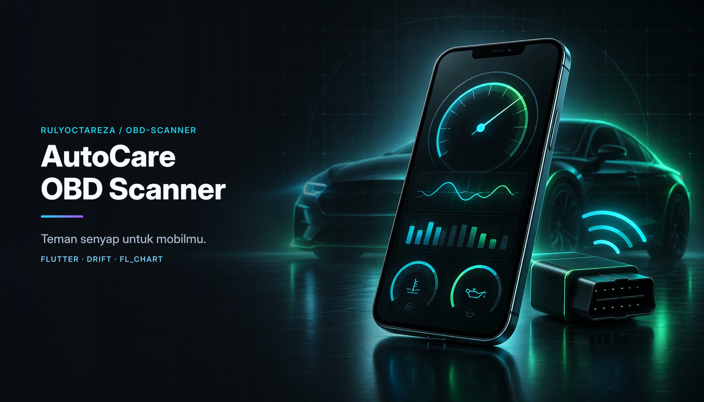
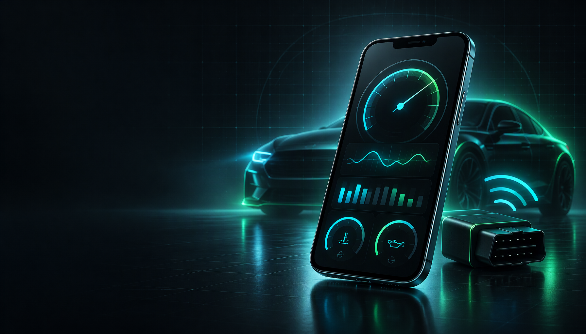

<p align="center">
  
</p>

<h1 align="center">AutoCare — OBD Scanner</h1>

<p align="center">
  <b>Teman senyap untuk mobilmu.</b><br>
  Baca data mesin real-time lewat adaptor OBD-II Bluetooth, catat perjalanan, dan pantau kesehatan kendaraan.
</p>

<p align="center">
  <a href="https://flutter.dev"></a>
  <a href="https://riverpod.dev"></a>
  <a href="https://drift.simonbinder.eu"></a>
  
</p>

---

## ✨ Preview

<p align="center">
  
</p>

> **Catatan:** gambar di atas adalah *ilustrasi konsep*, bukan screenshot asli.

---

## 📖 Tentang

AutoCare tersambung ke adaptor OBD-II via Bluetooth dan membaca data langsung dari ECU mobil:
putaran mesin, suhu, tegangan, dan parameter lain. Data ditampilkan sebagai gauge dan grafik,
lalu disimpan lokal agar riwayat perjalanan dan tren kesehatan mobil tetap bisa dilihat kapan saja.

---

## 🌟 Fitur

| Fitur | Deskripsi |
|---|---|
| 🔌 **Koneksi OBD-II Bluetooth** | Scan dan hubungkan adaptor OBD-II dari dalam aplikasi. |
| 📈 **Live Data** | Gauge dan grafik real-time untuk parameter mesin yang dibaca dari ECU. |
| 🩺 **Vehicle Health** | Ringkasan kondisi kendaraan berdasarkan data yang terkumpul. |
| 🧾 **Diagnostics** | Halaman diagnosa untuk membaca dan meninjau kode/parameter masalah. |
| 🛣️ **Trip Log** | Catat perjalanan beserta data mesin selama berkendara. |
| 🕘 **Timeline** | Riwayat aktivitas dan perjalanan dalam satu lini masa. |
| ☁️ **Background Service** | Tetap membaca data saat aplikasi berjalan di latar belakang. |
| 🌓 **Tema** | Light/Dark mode. |

---

## 🛠️ Tech Stack

| Area | Pilihan |
|---|---|
| Framework | Flutter (Dart 3) |
| State management | Riverpod + code generation |
| Database lokal | Drift (SQLite) |
| Routing | GoRouter |
| Bluetooth | `flutter_bluetooth_serial` |
| Grafik | `fl_chart` |
| Latar belakang | `flutter_background_service` |
| Izin & penyimpanan | `permission_handler`, `path_provider`, `shared_preferences` |

---

## 🧱 Struktur

```text
lib/
├── core/
│   ├── bluetooth/     # Koneksi & protokol adaptor
│   ├── database/      # Skema Drift
│   ├── obd/           # Pembacaan parameter OBD-II
│   ├── navigation/    # Router
│   ├── services/      # Service lintas fitur
│   ├── theme/         # Design tokens
│   └── widgets/       # Komponen bersama
└── features/
    ├── splash/
    ├── shell/         # Kerangka navigasi utama
    ├── live_data/     # Gauge & grafik real-time
    ├── diagnostics/
    ├── health/
    ├── trips/
    ├── timeline/
    └── settings/
```

---

## 🚀 Menjalankan

```bash
flutter pub get

# generate kode Drift & Riverpod
dart run build_runner build --delete-conflicting-outputs

flutter run
```

Butuh perangkat Android fisik dengan Bluetooth dan adaptor OBD-II (ELM327 atau sejenisnya).

---

## 🧪 Testing

```bash
flutter analyze
flutter test
```
