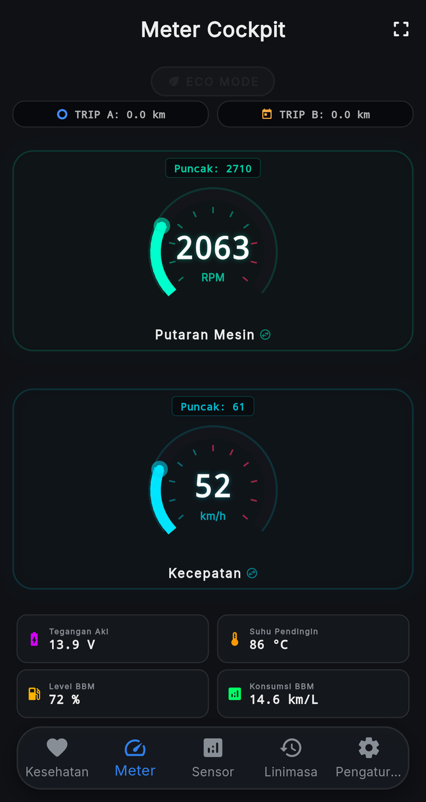
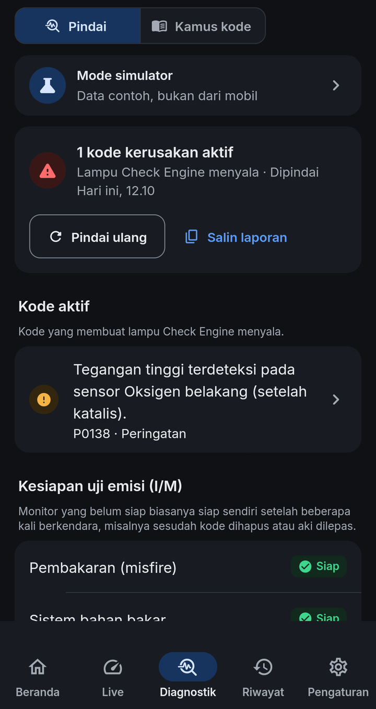
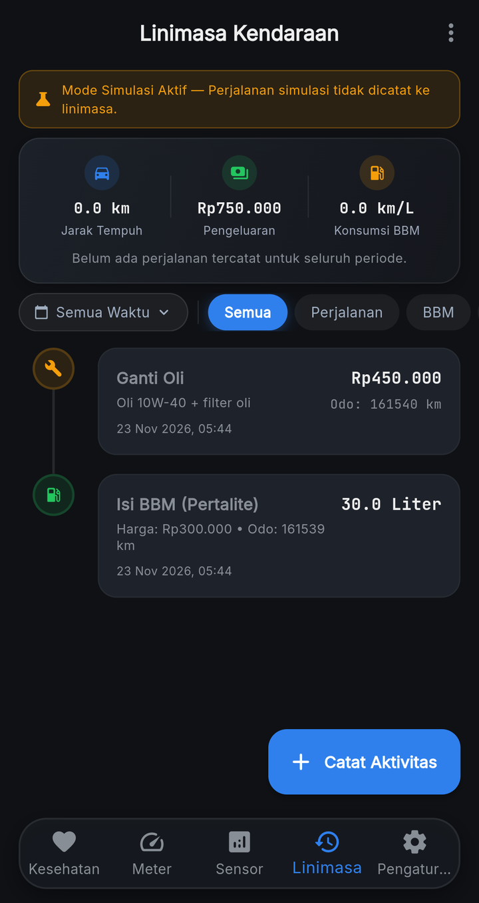
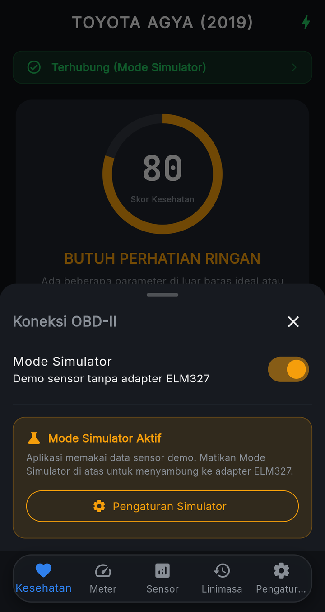
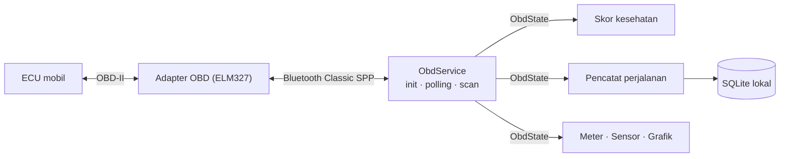

<p align="center">
  
</p>

<h1 align="center">AutoCare — OBD Scanner</h1>

<p align="center">
  <b>Teman senyap untuk mobilmu.</b><br>
  Ubah adapter OBD Bluetooth (ELM327) menjadi monitor kesehatan mobil: skor kesehatan, pindai kode kerusakan,<br>
  data live, serta riwayat perjalanan, isi BBM, dan servis. Semua dalam Bahasa Indonesia, semua tersimpan di HP.
</p>

<p align="center">
  <a href="https://flutter.dev"></a>
  
  
  
  <a href="LICENSE"></a>
</p>

<p align="center">
  <a href="https://rulyoctareza.github.io/OBD-Scanner/"><b>Situs</b></a> ·
  <a href="docs/alur-kerja.md"><b>Alur kerja</b></a> ·
  <a href="https://rulyoctareza.github.io/OBD-Scanner/privacy/"><b>Kebijakan privasi</b></a> ·
  <a href="docs/play-store.md"><b>Panduan rilis Play Store</b></a>
</p>

---

## 📱 Tampilan

<table>
  <tr>
    <td align="center"><br><sub><b>Skor kesehatan</b></sub></td>
    <td align="center"><br><sub><b>Live · Meter</b></sub></td>
    <td align="center"><br><sub><b>Live · Sensor</b></sub></td>
    <td align="center"><br><sub><b>Grafik sensor</b></sub></td>
  </tr>
  <tr>
    <td align="center"><br><sub><b>Diagnostik · Pindai</b></sub></td>
    <td align="center"><br><sub><b>Diagnostik · Kamus kode</b></sub></td>
    <td align="center"><br><sub><b>Riwayat</b></sub></td>
    <td align="center"><br><sub><b>Mode simulator</b></sub></td>
  </tr>
</table>

<sub>Screenshot asli dari aplikasi di Samsung Galaxy A6+ dengan mode simulator.</sub>

---

## ✨ Fitur

| | Fitur | Isinya |
|---|---|---|
| ❤️ | **Skor kesehatan mobil** | Skor 0–100 dari suhu mesin, aki dan alternator, putaran idle, kode kerusakan aktif, dan jadwal ganti oli. Status normal, waspada, atau kritis, lengkap dengan langkah berikutnya dan tombol menuju layar yang tepat. |
| 🛠️ | **Pindai kode kerusakan** | Baca kode kerusakan (DTC) aktif, tertunda, dan permanen, status lampu Check Engine, dan kesiapan uji emisi (I/M). Hapus kode kerusakan dan salin laporan pemindaian untuk bengkel. |
| 📖 | **Kamus kode** | Arti kode kerusakan dalam Bahasa Indonesia: gejala, kemungkinan penyebab, dan rekomendasi tindakan, dengan pencarian dan filter kategori. |
| ⏱️ | **Data live: Meter** | Dua gauge besar dan empat indikator kecil yang bisa diatur, petunjuk Hemat saat berkendara efisien, Trip A dan Trip B harian, plus mode layar penuh. |
| 📊 | **Data live: Sensor** | Putaran mesin, kecepatan, suhu mesin dan udara masuk, tegangan aki, MAP, MAF, bukaan gas, beban mesin, waktu pengapian, sisa BBM, perkiraan konsumsi BBM, dan grafik riwayat 1 menit sampai 1 jam. |
| 🧾 | **Riwayat perjalanan, isi BBM, dan servis** | Perjalanan tercatat otomatis (jarak, durasi, kecepatan rata-rata, suhu mesin tertinggi, km/L). Catat isi BBM dengan km/L metode isi penuh dan riwayat servis, semuanya dengan filter tanggal dan jenis. |
| 🔌 | **Menghubungkan tanpa ribet** | Cari dan pasangkan adapter dari dalam aplikasi (PIN 1234 otomatis), terhubung otomatis ke adapter terakhir, dan langkah perbaikan bila gagal. |
| 🪪 | **Identitas mobil** | Baca VIN dan odometer dari mobil (bila didukung), lalu terjemahkan VIN menjadi merek, model, dan tahun. |
| 🧪 | **Mode simulator** | Coba semua fitur tanpa adapter dengan data contoh, termasuk simulasi mesin terlalu panas, aki lemah, dan lampu Check Engine. |
| 🔒 | **Privat** | Tanpa akun, tanpa iklan, tanpa izin internet. Semua data tersimpan di SQLite lokal. |

Navigasi aplikasi: **Beranda · Live** (Meter, Sensor) **· Diagnostik** (Pindai, Kamus kode) **· Riwayat · Pengaturan**.

---

## ⚙️ Cara kerja singkat



1. **Menghubungkan**: lembar koneksi memeriksa Bluetooth dan izin, lalu membuka socket RFCOMM dan menjalankan `AT Z` → `AT E0` → `AT SP 0` → `0100` untuk menyiapkan adapter dan mendeteksi protokol mobil.
2. **Membaca**: 12 perintah dikirim bergiliran, satu per satu, menunggu prompt `>` setiap kali. Kode kerusakan dibaca setiap 20 siklus.
3. **Menghitung**: setiap jawaban memperbarui satu state; skor kesehatan, perjalanan, dan grafik menghitung ulang dari state itu.
4. **Menyimpan**: perjalanan, BBM, servis, dan pengaturan masuk ke database lokal. Tidak ada yang dikirim ke internet.

Penjelasan lengkap dengan diagram (urutan koneksi, status dan koneksi ulang, polling, pemindaian, skor kesehatan, perjalanan, database, simulator) ada di **[docs/alur-kerja.md](docs/alur-kerja.md)**.

---

## 🚗 Yang dibutuhkan

- **Adapter OBD Bluetooth Classic (ELM327).** Adapter khusus Bluetooth Low Energy (BLE) dan adapter Wi-Fi belum didukung.
- **Mobil dengan port OBD-II**, biasanya di bawah dasbor dekat setir. Sensor yang tersedia tergantung mobil; sensor yang tidak dilaporkan mobil ditandai "Tidak didukung", bukan ditampilkan nol. Rumus perkiraan konsumsi BBM disetel untuk mesin bensin kecil (acuan: Toyota Agya 1.2).
- **HP Android 7.0 (API 24) atau lebih baru.** iOS belum didukung.

## 🚀 Mulai pakai

1. Colokkan adapter ke port OBD-II, lalu nyalakan kontak mobil.
2. Buka AutoCare, ikuti intro, dan izinkan akses **Perangkat di sekitar** (Bluetooth).
3. Ketuk **Hubungkan** → cari → pilih adapter. PIN 1234 diisi otomatis.
4. Skor kesehatan di **Beranda** dan data di **Live** langsung terisi. Buka **Diagnostik → Pindai** untuk membaca kode kerusakan.

Tidak punya adapter? Pilih mode simulator di intro, atau nyalakan di **Pengaturan → Simulator**.

## 🔒 Privasi

AutoCare tidak mengumpulkan atau membagikan data. Aplikasi tidak memiliki izin internet, akun, iklan, maupun analitik. Lokasi hanya diminta di Android 11 ke bawah karena Android mewajibkannya untuk mencari perangkat Bluetooth, dan tidak pernah dibaca. Selengkapnya di [kebijakan privasi](https://rulyoctareza.github.io/OBD-Scanner/privacy/).

---

## 🛠️ Untuk pengembang

### Tech stack

| Area | Pilihan |
|---|---|
| Framework | Flutter 3.35, Dart 3.9 |
| State | Riverpod (`StateNotifier` + provider yang ditulis manual) |
| Navigasi | go_router dengan `StatefulShellRoute` (5 tab) |
| Database | Drift (SQLite), skema v3 dengan migrasi |
| Bluetooth | `flutter_bluetooth_serial` 0.4.0, **di-vendor** di `packages/` dengan patch Android ([LOCAL_CHANGES.md](packages/flutter_bluetooth_serial/LOCAL_CHANGES.md)) |
| Grafik | fl_chart |
| Latar belakang | Foreground service Android tipe `connectedDevice`, hanya saat adapter terhubung |
| Render | Skia/OpenGL (Impeller dimatikan karena crash driver Vulkan di GPU lama seperti Adreno 506) |

### Struktur proyek

```text
lib/
├── core/
│   ├── bluetooth/   # ObdService (koneksi, init, polling, pemindaian), akses & pairing Bluetooth
│   ├── obd/         # parser PID/DTC/readiness, dekoder VIN, simulator
│   ├── database/    # skema Drift dan migrasi
│   ├── navigation/  # router
│   ├── services/    # foreground service
│   ├── theme/       # warna dan tipografi
│   ├── utils/       # helper grafik, laporan pemindaian, aksi peringatan
│   └── widgets/     # lembar koneksi adapter OBD
└── features/
    ├── splash/      # splash + intro OBD
    ├── shell/       # navigasi bawah 5 tab
    ├── health/      # Beranda: skor kesehatan (HealthEngine)
    ├── live_data/   # Live: meter, sensor, grafik
    ├── diagnostics/ # Diagnostik: pemindaian + kamus kode
    ├── trips/       # pencatat perjalanan, Trip A/B
    ├── timeline/    # Riwayat: perjalanan, isi BBM, servis
    └── settings/    # pengaturan, simulator, identitas mobil
packages/flutter_bluetooth_serial/   # plugin Bluetooth yang di-vendor
fastlane/metadata/android/           # teks dan gambar listing Play Store (id, en-US)
tool/store_assets/                   # skrip pembuat screenshot dan grafis listing
docs/                                # dokumentasi + situs GitHub Pages
```

### Menjalankan

```bash
flutter pub get
dart run build_runner build --delete-conflicting-outputs   # hanya setelah mengubah tabel Drift
flutter run
```

Koneksi asli butuh HP Android fisik dengan Bluetooth dan adapter OBD (ELM327). Tanpa itu, semua layar tetap bisa dicoba di emulator lewat mode simulator.

### Test dan analisis

```bash
flutter analyze
flutter test
```

### Build rilis

```bash
tool/build_verified.sh appbundle --release
```

Skrip ini membungkus `flutter build` dan memastikan kode Dart terbaru benar-benar ikut terkemas. Ini perlu karena path proyek yang berisi spasi bisa membuat Gradle memakai hasil kompilasi lama. Build rilis ditandatangani dengan upload key dari `android/key.properties` (tidak di-commit). Cara membuatnya, isian Play Console, dan checklist rilis ada di **[docs/play-store.md](docs/play-store.md)**. Screenshot dan grafis listing dibuat ulang dengan [`tool/store_assets/`](tool/store_assets/README.md).

---

## 🤝 Kontribusi

Laporan bug dan usulan fitur sangat membantu, terutama yang menyertakan HP, adapter, dan mobil yang dipakai. Gunakan [template issue](https://github.com/RulyOctareza/OBD-Scanner/issues/new/choose). Pull request dipersilakan; jalankan `flutter analyze` dan `flutter test` sebelum mengirim.

> AutoCare membantu memantau kondisi mobil, tetapi bukan pengganti pemeriksaan di bengkel. Atur aplikasi sebelum berangkat, jangan sambil mengemudi.

## 📄 Lisensi

[MIT](LICENSE) © 2026 Fatchurizkia Ruly Octareza
