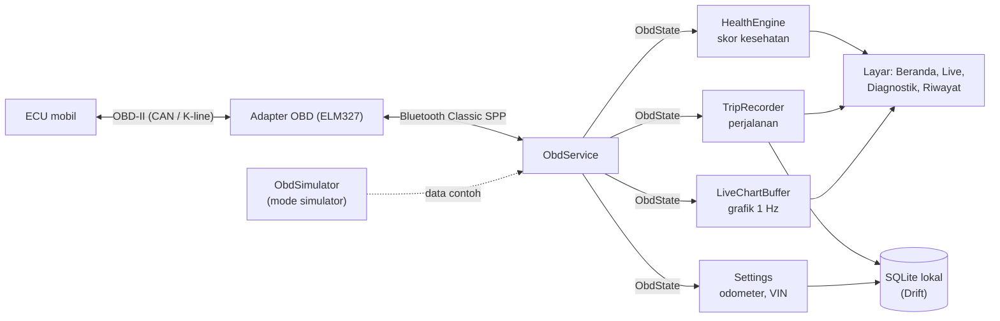
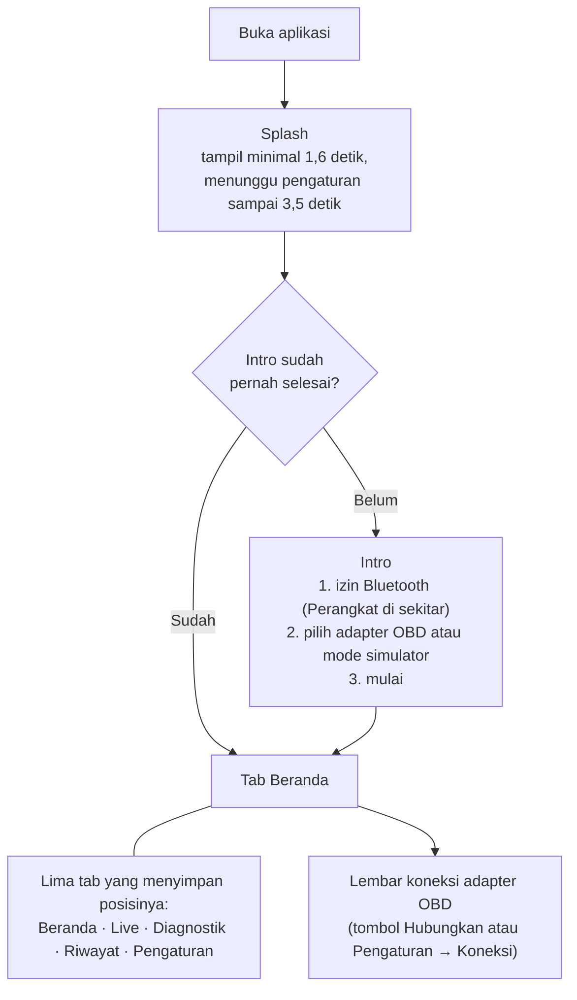
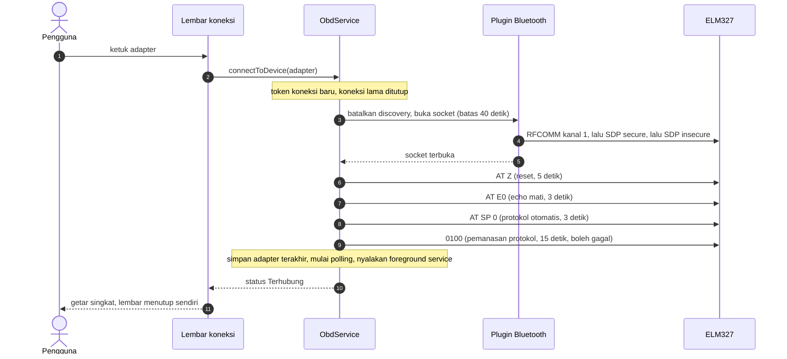
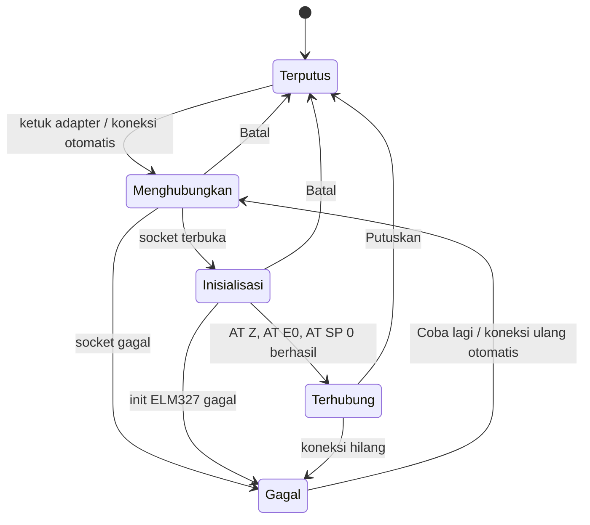
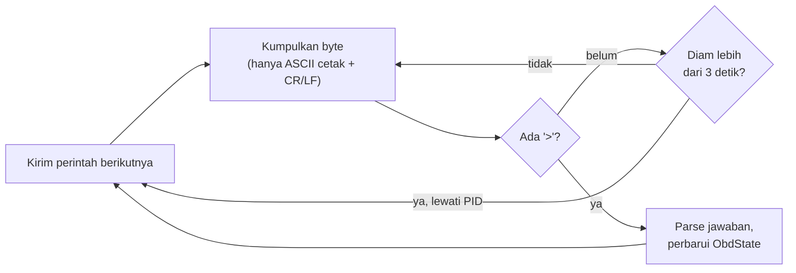
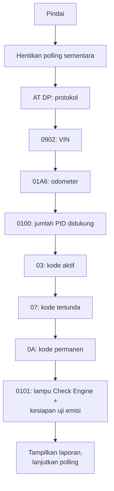
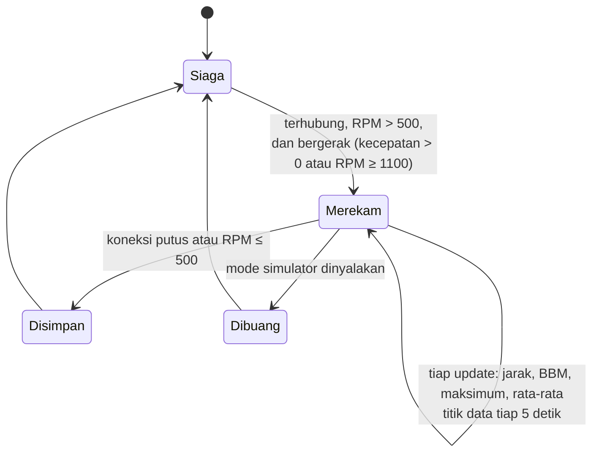
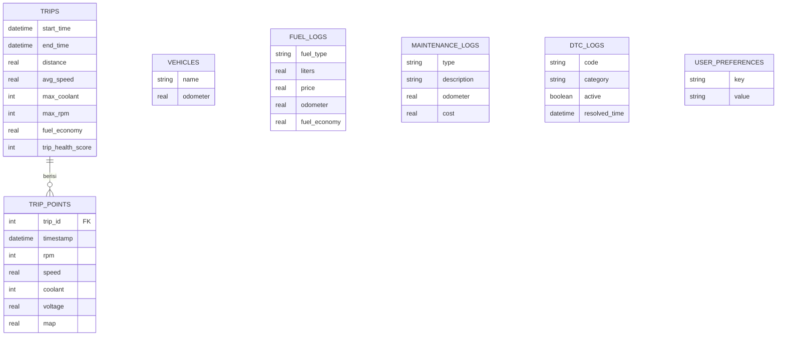
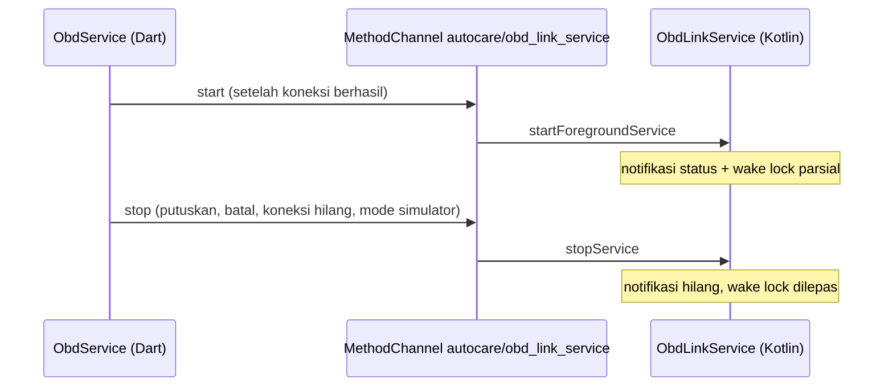

# Alur kerja AutoCare

Dokumen ini menjelaskan cara AutoCare bekerja dari ujung ke ujung: dari adapter OBD (ELM327) yang dicolokkan ke mobil, sampai skor kesehatan, catatan perjalanan, dan data yang tersimpan di HP. Ditulis untuk pengguna yang penasaran dan untuk developer yang akan mengubah kodenya.

**Daftar isi**

1. [Gambaran besar](#1-gambaran-besar)
2. [Perjalanan pengguna di aplikasi](#2-perjalanan-pengguna-di-aplikasi)
3. [Menghubungkan ke adapter](#3-menghubungkan-ke-adapter)
4. [Membaca data: polling ELM327](#4-membaca-data-polling-elm327)
5. [Pemindaian dan kode kerusakan](#5-pemindaian-dan-kode-kerusakan)
6. [Skor kesehatan](#6-skor-kesehatan)
7. [Pencatatan perjalanan](#7-pencatatan-perjalanan)
8. [Grafik dan metrik turunan](#8-grafik-dan-metrik-turunan)
9. [Penyimpanan data](#9-penyimpanan-data)
10. [Mode simulator](#10-mode-simulator)
11. [Berjalan di latar belakang](#11-berjalan-di-latar-belakang)
12. [Peta kode](#12-peta-kode)

---

## 1. Gambaran besar

AutoCare berbicara dengan mobil lewat satu adapter OBD **ELM327 Bluetooth Classic** (profil SPP/RFCOMM). Adapter menerjemahkan perintah teks seperti `010C` menjadi permintaan OBD-II ke ECU, lalu mengembalikan jawabannya sebagai teks heksadesimal. Semua komunikasi dipegang satu objek, `ObdService`, yang menerbitkan satu state (`ObdState`). Seluruh fitur lain bereaksi terhadap state itu.



Tidak ada server, akun, atau sinkronisasi. Semua data tinggal di HP.

## 2. Perjalanan pengguna di aplikasi



| Tab | Isi |
|---|---|
| **Beranda** | Status koneksi, skor kesehatan mobil, hal yang perlu perhatian beserta tombol aksinya, pemeriksaan sistem, ringkasan perjalanan terakhir |
| **Live** | Segmen **Meter** (dua gauge besar, empat indikator kecil yang bisa diatur, petunjuk Hemat, Trip A/B, layar penuh) dan **Sensor** (semua sensor; ketuk untuk grafik riwayatnya) |
| **Diagnostik** | Segmen **Pindai** (kode kerusakan, lampu Check Engine, kesiapan uji emisi) dan **Kamus kode** |
| **Riwayat** | Perjalanan, isi BBM, dan servis dalam satu urutan waktu, dengan filter dan ringkasan |
| **Pengaturan** | Bagian Mobil (nama, VIN, odometer, target ganti oli), Koneksi (adapter, hubungkan otomatis), Simulator (mode simulator dan saklar simulasinya), dan Tentang |

Bila lima label tidak muat di layar kecil, Pengaturan pindah ke ikon gir di Beranda dan bar bawah tinggal empat tab.

## 3. Menghubungkan ke adapter

### 3.1 Kesiapan Bluetooth

Sebelum menampilkan daftar perangkat, lembar koneksi memeriksa apa yang menghalangi, supaya pengguna melihat cara memperbaikinya, bukan daftar kosong.

| Kondisi | Yang ditampilkan |
|---|---|
| Bluetooth Classic tidak ada | Saran memakai mode simulator |
| Izin ditolak | Tombol "Izinkan" untuk meminta ulang |
| Izin ditolak permanen | Tombol ke halaman izin aplikasi |
| Bluetooth mati | "Nyalakan Bluetooth" (dialog sistem), lalu daftar dimuat ulang |
| Siap | Daftar adapter |

Izin yang diminta adalah `BLUETOOTH_CONNECT` untuk daftar dan koneksi, ditambah `BLUETOOTH_SCAN` untuk mencari perangkat baru. Lokasi hanya diminta di Android 11 ke bawah, dan hanya saat mencari perangkat baru, karena Android versi itu mewajibkannya untuk pencarian Bluetooth Classic.

### 3.2 Daftar perangkat dan pairing

- **Adapter yang sudah dipasangkan**: adapter terakhir dipakai paling atas, lalu perangkat yang namanya mirip adapter OBD (OBD, ELM, Vgate, iCar, Konnwei, Viecar, BAFX, Carista, …).
- **Perangkat Bluetooth lain**: perangkat lain yang sudah dipasangkan, diciutkan. Perangkat khusus BLE disembunyikan karena SPP tidak bisa menjangkaunya.
- **Perangkat baru → Cari**: pencarian Bluetooth Classic (sekitar 12 detik). Mengetuk hasilnya akan memasangkannya dengan PIN **1234** otomatis; kalau gagal, dialog PIN Android muncul (misalnya untuk PIN 0000). Setelah berhasil, AutoCare langsung menghubungkan.

### 3.3 Urutan koneksi



- Koneksi manual dicoba sampai **2 kali**, auto-connect **1 kali**. Teks langkah ("Membuka koneksi Bluetooth…", "Menyiapkan adapter ELM327…", "Mendeteksi protokol mobil…") tampil di lembar koneksi.
- Setiap perintah init dicoba dua kali. Pemanasan `0100` memberi waktu pencarian protokol, yang di mobil K-line bisa makan beberapa detik. Tanpa pemanasan, polling akan memotong pencarian itu. Bila mobil tidak menjawab (misalnya kontak mati), koneksi tetap dianggap terhubung.
- Bila gagal, pesan singkat tampil di banner, dan **Langkah perbaikan** (adapter tidak bertenaga, dipakai aplikasi lain, pasangan Bluetooth basi, perangkat salah) tampil di lembar koneksi bersama tombol **Coba lagi**.
- **Batal** dan **Putuskan** selalu berakhir di status terputus, bukan gagal.

### 3.4 Status koneksi dan koneksi ulang



- Saat aplikasi dibuka, koneksi otomatis menunggu **3 detik** (memberi waktu adapter melepas socket sesi sebelumnya), lalu memakai alamat adapter terakhir tanpa meminta izin apa pun.
- Koneksi ulang otomatis memakai jeda bertingkat **15 → 30 → 60 → 120 detik** (maksimal). Setelah koneksi berhasil, jeda kembali ke 15 detik dan cek berikutnya langsung dijadwalkan ulang, sehingga link yang putus di jalan dicoba lagi paling lambat 15 detik kemudian.
- Koneksi otomatis, baik saat aplikasi dibuka maupun koneksi ulang berkala, memakai satu aturan yang sama: hubungkan otomatis aktif di Pengaturan, mode simulator mati, adapter sedang tidak terhubung, pengguna tidak baru saja menekan **Batal** atau **Putuskan**, dan lembar koneksi tidak sedang terbuka. Larangan karena Batal/Putuskan baru dicabut saat pengguna menghubungkan secara manual atau menyalakan lagi hubungkan otomatis.

Adapter ELM327 hanya menerima **satu** klien. Socket yang terbuka tapi tidak dilacak akan membuat adapter "sibuk" sampai aplikasi ditutup paksa. Karena itu setiap percobaan koneksi membawa token, setiap socket membawa nomor generasi, dan socket yang baru terbuka setelah batas waktu atau setelah dibatalkan langsung ditutup.

## 4. Membaca data: polling ELM327

ELM327 mengakhiri setiap jawaban dengan prompt `>`, dan hanya **satu perintah** boleh berjalan dalam satu waktu. Perintah kedua yang dikirim sebelum `>` merusak kedua jawaban.



Urutan polling, diulang terus tanpa jeda:

| Perintah | Data | Rumus |
|---|---|---|
| `AT RV` | Tegangan aki (dibaca adapter) | angka dari jawaban, V |
| `010C` | Putaran mesin | (A·256 + B) / 4 rpm |
| `010D` | Kecepatan | A km/jam |
| `0105` | Suhu mesin (cairan pendingin) | A − 40 °C |
| `010F` | Suhu udara masuk | A − 40 °C |
| `010B` | Tekanan intake (MAP) | A kPa |
| `0110` | Aliran udara (MAF) | (A·256 + B) / 100 g/s |
| `010E` | Waktu pengapian | A / 2 − 64 ° |
| `0111` | Bukaan gas | A · 100 / 255 % |
| `0104` | Beban mesin | A · 100 / 255 % (`FF` dianggap tidak didukung) |
| `01A6` | Odometer | ABCD / 10 km (hanya ECU baru) |
| `012F` | Sisa BBM | A · 100 / 255 % |
| `03` | Kode kerusakan aktif | di akhir siklus pertama tiap koneksi, lalu sekali tiap **20 siklus** |

- Jawaban dicari dari kemunculan **terakhir** `41`+PID, sehingga echo, `SEARCHING...`, dan header multi-ECU di depannya terlewati.
- PID yang tidak pernah menjawab ditandai "tidak didukung ECU ini". Meter dan Sensor menampilkan status itu, bukan angka nol yang menyesatkan.
- Perintah sekali jalan (scan diagnostik, baca VIN/odometer, hapus DTC) dijalankan lewat satu antrean yang **menghentikan polling**, menunggu jawaban poll yang sedang berjalan (maksimal 3 detik), menjalankan perintahnya, lalu memulai polling lagi.

## 5. Pemindaian dan kode kerusakan



- Setiap langkah punya batas waktu sendiri (3–4 detik). Langkah yang tidak dijawab dilewati, bukan dianggap gagal, karena banyak mobil lama tidak mendukung `0902`, `01A6`, atau `0A`.
- **Lampu Check Engine (MIL)** diambil dari bit 7 byte A `0101`. **Kesiapan uji emisi (I/M)** mencakup pengapian, sistem bahan bakar, komponen, katalis, EVAP, sensor O2, pemanas O2, dan EGR.
- VIN yang valid diterjemahkan menjadi merek, model (untuk model populer di Indonesia), dan tahun, lalu dipakai sebagai nama mobil di Pengaturan.
- **Jawaban 03 yang dipercaya.** Daftar kode dan status "sudah dipindai" hanya berubah oleh jawaban yang memuat header `43`. `NO DATA` berarti "tidak ada kode" hanya bila ECU terbukti hidup: di polling ada PID yang terjawab di siklus yang sama, di pemindaian `0902`, `01A6`, atau `0100` terjawab. Dengan kontak mati, adapter menjawab `NO DATA` untuk semua perintah, jadi aplikasi tetap menulis "belum dipindai", bukan "tidak ada masalah". Jawaban lain (`ERROR`, `?`, `CAN ERROR`, `SEARCHING` saja) tidak mengubah kode yang sudah terbaca. Hasil pemindaian membawa `activeDtcsRead` untuk membedakan "tidak ada kode" dari "belum terbaca".
- **Hapus kode kerusakan** tidak percaya begitu saja pada jawaban mode `04`. Dalam satu antrean, aplikasi membaca `03`, mengirim `04`, menunggu 500 ms, lalu membaca `03` lagi:

  ```mermaid
  flowchart LR
      B["03: kode sebelum"] --> C["04: hapus"] --> W["jeda 500 ms"] --> A["03: baca balik"]
      A --> R{"Hasil baca balik"}
      R -- "kosong" --> OK["Terhapus semua"]
      R -- "sebagian hilang" --> PA["Sebagian"]
      R -- "tidak ada yang hilang" --> RJ["Ditolak"]
      R -- "tidak terjawab" --> F["Gagal: data tidak diubah"]
  ```

  Banyak mobil hanya mengizinkan hapus kode saat kontak ON dan mesin mati, sehingga hasil "ditolak" itu wajar. Hanya kode yang benar-benar hilang yang dicatat ke riwayat `dtc_logs`. Lampu Check Engine ikut mati dan data kesiapan uji emisi ikut terhapus, tetapi kerusakannya belum tentu hilang.
- **Kamus kode** berisi kode umum dengan judul, kategori, tingkat bahaya, deskripsi berbahasa Indonesia, gejala, kemungkinan penyebab, dan rekomendasi. Kode yang tidak dikenal mendapat penjelasan umum berdasarkan hurufnya (P/C/B/U). Laporan pemindaian bisa disalin sebagai teks untuk dikirim ke bengkel.

## 6. Skor kesehatan

`HealthEngine` menghitung ulang skor setiap kali data berubah, jadi layar Kesehatan adalah **potret saat ini**, bukan tren.

| Pemeriksaan | Kondisi | Pengurangan |
|---|---|---|
| Suhu mesin | > 115 °C (kritis) / > 105 °C / > 100 °C | −35 / −15 / −5 |
| Aki, mesin hidup | < 12,8 V (pengisian/alternator lemah) | −15 |
| Aki, mesin mati | < 11,8 V (aki lemah) | −10 |
| Kode kerusakan | per kode aktif | −20 |
| Idle | mesin hidup, diam, RPM di luar 650–1100 | −5 |
| Oli | odometer melewati target ganti oli / kurang dari 2.500 km lagi | −10 / −2 |

Skor mulai dari 100 dan dibatasi 0–100. **≥ 95** berarti kondisi baik, **80–94** perlu perhatian ringan, dan **< 80** mobil perlu segera diperiksa. Satu kode kerusakan aktif saja sudah cukup untuk masuk kelompok terakhir. Setiap peringatan punya tombol aksi ke layar yang relevan (Live, Diagnostik, atau Riwayat). Target ganti oli diatur manual, atau otomatis menjadi odometer + 5.000 km setiap kali catatan "Ganti Oli" disimpan.

## 7. Pencatatan perjalanan



- Jarak dihitung dari kecepatan OBD terhadap waktu nyata (bukan GPS). Jeda ≥ 10 detik (misalnya saat koneksi ulang) tidak dihitung sebagai jarak.
- Saat disimpan: waktu selesai, jarak, kecepatan rata-rata, suhu dan RPM maksimum, durasi, menit idle, konsumsi km/L, dan skor kesehatan perjalanan (−15 bila suhu pernah > 105 °C, −20 lagi bila > 115 °C). Jarak perjalanan ditambahkan ke odometer.
- **Trip A** berjalan sampai direset. **Trip B** adalah meter harian yang kembali ke 0 setiap hari baru. Keduanya bisa direset lewat menu di Live → Meter (Reset Trip A / Reset Trip B), dengan konfirmasi.
- Tidak ada perjalanan yang dicatat dalam mode simulator, supaya data contoh tidak bercampur dengan riwayat asli.

## 8. Grafik dan metrik turunan

**Grafik riwayat** menggabungkan titik data perjalanan yang tersimpan dengan buffer live 1 Hz di memori (maksimal sekitar 1 jam). Buffer hanya mengambil sampel selama ada grafik yang terbuka. Rentang yang tersedia adalah 1 mnt, 5 mnt, 15 mnt, 1 jam, dan Semua. Nilai yang berarti "belum ada data" dibuang, titik yang terlalu rapat digabung, lalu jumlah titik dikurangi sampai maksimal 200.

**Konsumsi BBM (km/L)** tidak tersedia sebagai PID, jadi diperkirakan dari aliran bahan bakar:

1. Ada MAF: aliran (L/jam) = MAF × 3600 / (14,7 × 740).
2. Hanya MAP: massa udara dihitung dengan hukum gas ideal dari MAP, RPM, dan suhu intake, dengan asumsi mesin **1,2 L** dan efisiensi volumetrik 80 % (disetel untuk mobil acuan, Toyota Agya).
3. Tidak ada keduanya: perkiraan kasar dari RPM dan beban mesin.

Hasilnya 0 saat mesin mati atau kecepatan < 2 km/jam, dan dibatasi maksimal 50 km/L. Petunjuk **Hemat** di Meter menyala saat kecepatan > 10 km/jam, putaran mesin 1200–2000 rpm, bukaan gas < 25 %, dan beban mesin < 40 %.

## 9. Penyimpanan data

Semua data disimpan di satu file SQLite (`autocare.db`, lewat Drift) di penyimpanan internal aplikasi.



- `vehicles` hanya memakai satu baris; banyak mobil belum didukung.
- `user_preferences` menyimpan pengaturan sebagai pasangan kunci–nilai, misalnya nama mobil, odometer, target oli, pilihan gauge, mode simulator, hubungkan otomatis, adapter terakhir, dan Trip A/B.
- **Odometer** punya beberapa penulis: PID `01A6` dari ECU (bila didukung), penambahan jarak di akhir perjalanan, dan angka yang diketik saat mencatat BBM atau servis.
- **km/L isi BBM** memakai metode isi penuh ke isi penuh: (odometer sekarang − odometer isi sebelumnya) / liter isi sekarang.
- Kolom baru di tabel wajib nullable atau punya nilai default, dan ditambahkan di migrasi (`onUpgrade`).

## 10. Mode simulator

Mode simulator mengalirkan data contoh lewat `ObdState` yang sama dengan koneksi asli, sehingga setiap layar bisa dicoba tanpa mobil. `ObdSimulator` mengirim data setiap 500 ms: kecepatan bergelombang 0–75 km/jam, RPM mengikuti model gigi sederhana, odometer mulai dari 161.420 km, dan BBM mulai dari 72,5 %. Simulasi hanya maju pada tick timer; menekan saklar simulasi hanya mengirim ulang kondisi terakhir, sehingga odometer tidak bertambah sendiri.

| Saklar simulasi (Pengaturan → Simulator) | Efek |
|---|---|
| Mesin menyala | Mati: putaran mesin 0, kecepatan 0, suhu mesin turun pelan |
| Mesin terlalu panas | Target suhu mesin 109 °C |
| Aki lemah | Tegangan 11,4 V saat mesin hidup |
| Lampu Check Engine | Menambahkan kode kerusakan `P0138` |

Pemindaian dalam mode simulator berjalan bertahap dengan data contoh dan VIN contoh yang diterjemahkan menjadi "Toyota Agya (2019)". Menyalakan mode simulator memutus koneksi asli dan menghentikan koneksi ulang otomatis.

## 11. Berjalan di latar belakang

Saat adapter asli terhubung, AutoCare menyalakan **foreground service** bertipe `connectedDevice` dengan notifikasi status. Service ini tidak membaca OBD sendiri; tugasnya menjaga proses aplikasi tetap hidup, sehingga socket Bluetooth dan polling tidak dimatikan Android saat pengguna membuka aplikasi lain, misalnya navigasi.



- Service native ditulis di Kotlin tanpa engine Flutter kedua, tidak di-*export*, dan memakai `START_NOT_STICKY`, jadi Android tidak menghidupkannya ulang sendiri.
- Wake lock parsial hanya dipegang selama link terbuka, dengan batas aman 6 jam.
- Tidak ada penerima boot: service tidak pernah menyala sendiri saat HP dinyalakan atau saat aplikasi diperbarui.

## 12. Peta kode

| Bagian | File |
|---|---|
| Koneksi, init ELM327, polling, scan, reconnect | `lib/core/bluetooth/obd_service.dart` |
| Kesiapan Bluetooth, daftar perangkat, pairing | `lib/core/bluetooth/bluetooth_access.dart` |
| Lembar koneksi | `lib/core/widgets/obd_connection_sheet.dart` |
| Plugin Bluetooth (vendored, dengan patch Android) | `packages/flutter_bluetooth_serial/` (lihat `LOCAL_CHANGES.md`) |
| Parser PID, DTC, readiness, VIN | `lib/core/obd/obd_parser.dart`, `lib/core/obd/vin_decoder.dart` |
| Simulator | `lib/core/obd/obd_simulator.dart` |
| Skor kesehatan | `lib/features/health/domain/health_engine.dart` |
| Pencatatan perjalanan, Trip A/B | `lib/features/trips/presentation/trip_provider.dart` |
| Grafik riwayat | `lib/features/live_data/presentation/telemetry_provider.dart`, `live_chart_buffer.dart` |
| Kamus DTC | `lib/features/diagnostics/data/dtc_repository.dart` |
| Database dan migrasi | `lib/core/database/database.dart` |
| Pengaturan dan preferensi | `lib/features/settings/presentation/settings_provider.dart` |
| Navigasi | `lib/core/navigation/router.dart` |
| Foreground service | `lib/core/services/background_service.dart` (sisi Dart), `android/app/src/main/kotlin/com/autocare/autocare/ObdLinkService.kt` (service native) |
